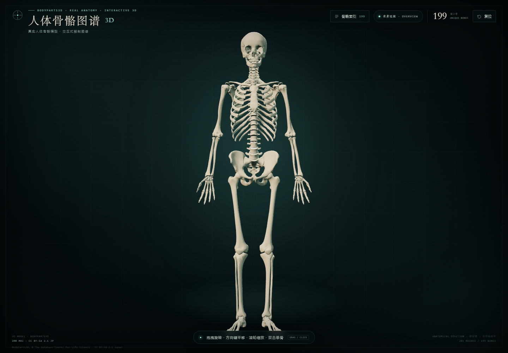
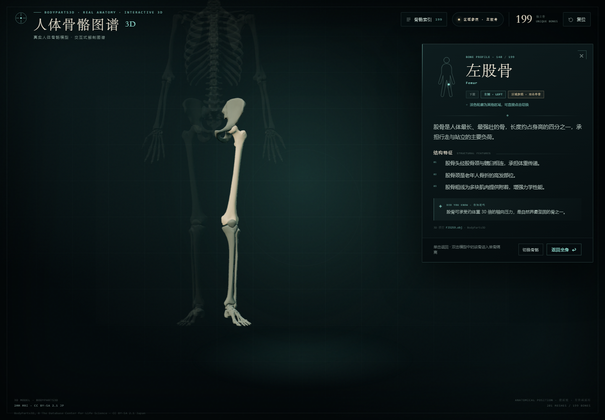
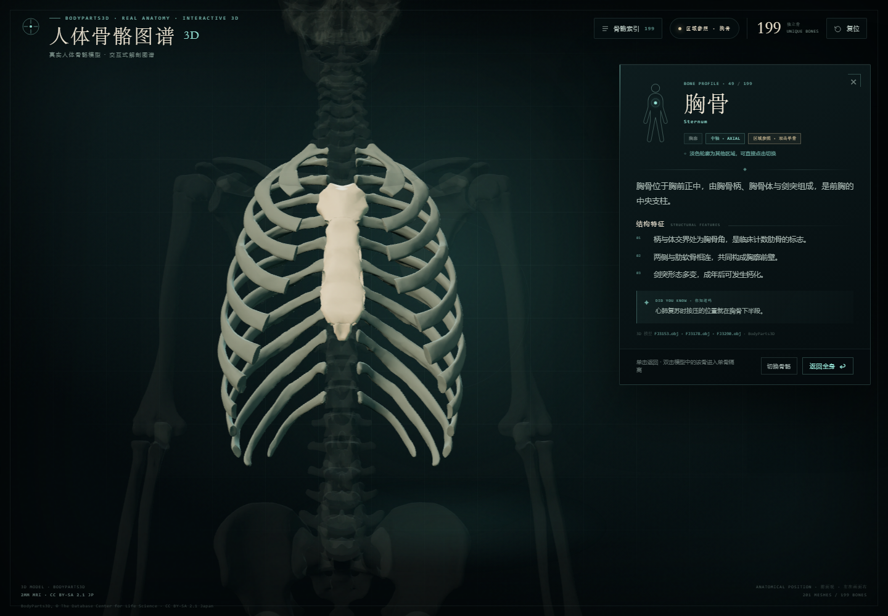
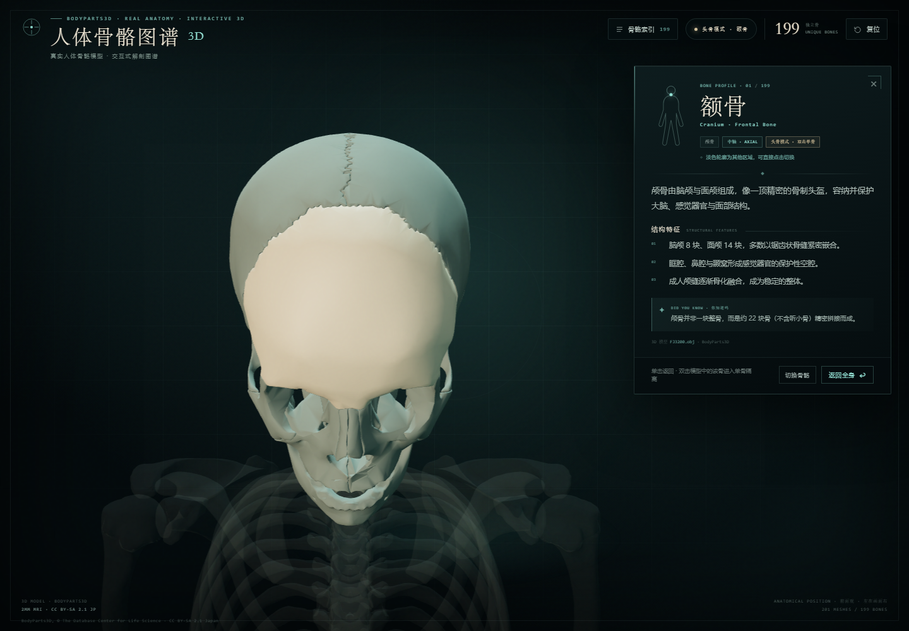
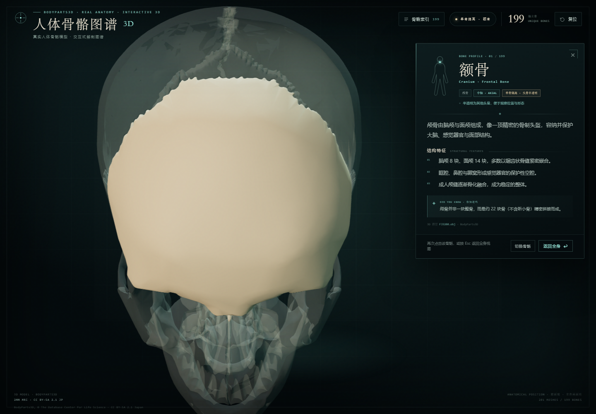
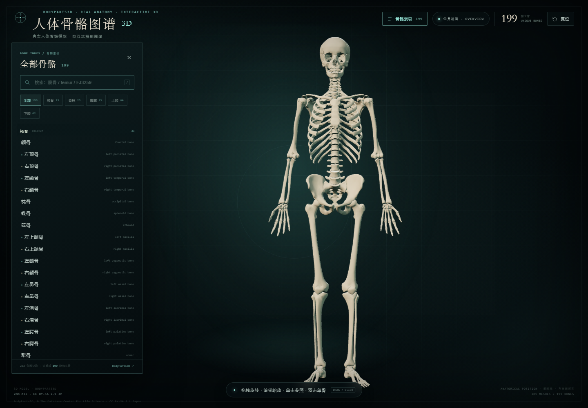
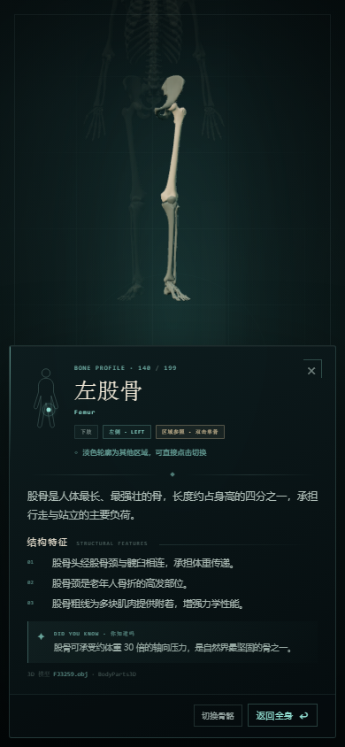

# 人体骨骼图谱 3D · BodyParts3D 真实骨骼模型

基于 **BodyParts3D / Anatomography** 真实人体 MRI 数据构建的交互式 3D 骨骼图谱。包含 201 个真实骨骼模型部件，支持“单击区域参照 / 双击单骨隔离”的全身交互。

**所有模型已内嵌到程序中，双击 `index.html` 即可直接打开，不需要本地服务器。**

> 更简洁的入门说明见 [简介与使用说明.md](简介与使用说明.md)。















## 直接打开

1. 解压整个 `skeleton-3d` 文件夹（不要只移动 `index.html`）。
2. 双击 `index.html`。
3. 等待加载进度完成即可。

模型以约 13 MB 的压缩数据内嵌在 `js/models-embedded.js` 中，首次打开需要解压和解析，通常几秒钟；后续浏览器会缓存脚本，打开更快。

### 浏览器要求

程序使用浏览器内置的 `DecompressionStream` 解压模型：

- Chrome / Edge 80+
- Firefox 113+
- Safari 16.4+

## 上传到 GitHub

仓库需要把**程序文件放在根目录**：`index.html`、`css/`、`js/`、`libs/`、`README.md` 等与 `.gitignore` 同级。

### 网页上传

1. 新建一个空仓库；
2. 解压 `skeleton-3d-github.zip`，把解压出来的**内容**上传到仓库根目录（不要上传外层 zip 作为程序文件）；
3. 填写提交信息并提交。

`js/models-embedded.js` 约 13.5 MB，低于 GitHub 单文件 100 MB 限制，也低于网页上传的单文件 25 MB 限制。

如果网页上传较慢或失败，可以使用 GitHub Desktop 或 Git 命令行上传整个文件夹。

### 开启 GitHub Pages

1. 进入仓库 **Settings → Pages**；
2. **Build and deployment** 选择 **Deploy from a branch**；
3. 分支选择 `main`，目录选择 `/ (root)`，保存；
4. 等待部署完成，访问 `https://<用户名>.github.io/<仓库名>/`。

仓库已包含 `.nojekyll`，可避免 GitHub Pages 对静态文件做 Jekyll 处理。

## 交互方式

| 操作 | 效果 |
|---|---|
| 左键拖拽 | 旋转 3D 模型 |
| 右键拖拽 / Shift + 拖拽 | 平移视角 |
| 滚轮 / 双指捏合 | 缩放 |
| 单击任意骨骼 | **区域参照模式**：本区域显示为暗色实体，其他区域保留为淡色可点击轮廓，点击的骨块高亮 |
| 双击任意骨骼 | **单骨隔离**：只显示被双击的那一块骨，其余 200 个模型部件全部隐藏 |
| 面板“切换骨骼” | 打开骨骼索引，直接切换到其他区域，不返回全身视图 |
| 方向键 `↑` `↓` `←` `→` | 平移虚拟摄像机与观察目标，可沿长骨上下左右移动视角；移动速度随镜头距离自动缩放 |
| 单骨隔离后再次单击 / 按 `Esc` | 恢复全身视图 |
| 再次单击同一骨骼 | 返回全身视图 |
| 点击空白区域 / 关闭按钮 / “返回全身” | 返回全身视图 |
| 悬停骨骼 | 高亮并显示名称提示 |
| 左侧“骨骼索引” | 搜索或按分区浏览全部 199 个骨骼条目；区域参照中打开索引不会重置视角 |
| 按 `[` / `]` | 切换上一块 / 下一块骨 |
| 按 `/` | 打开骨骼索引并聚焦搜索框 |
| 深链接 | 例如 `index.html#FJ3259`（左股骨）、`index.html#sternum`（胸骨） |

> 为区分单击与双击，骨骼单击会有约 260ms 的确认延迟。

方向键按屏幕方向平移摄像机与观察目标，速度随镜头距离自动缩放：全身视图移动较快，近距离观察股骨、胫骨等长骨时更精细。索引抽屉打开或搜索框聚焦时，方向键保留给界面滚动和光标移动。

在手机上，骨骼档案以底部抽屉出现；索引为全屏抽屉。

## 区域参照的范围

单击骨骼时，程序会根据解剖部位保留最相关的局部骨骼；其他区域以淡色轮廓显示，可直接点击切换。也可以使用面板底部的“切换骨骼”打开索引，选中其他骨骼后直接进入新区域：

| 点击部位 | 保留的参照骨骼 |
|---|---|
| 颅骨任意骨 | 全部头骨（23 块） |
| 颈椎 | 颈椎 C1–C7 |
| 胸椎 | 胸椎 T1–T12 |
| 腰椎 | 腰椎 L1–L5 |
| 骶骨 | 骶骨与骨盆 |
| 胸骨、肋骨 | 全部肋骨 + 胸骨 |
| 肩带 / 上臂 / 前臂 / 腕骨 / 掌骨 / 指骨 | **同侧上肢 + 同侧手部（32 个部件）** |
| 髋骨 / 股骨 / 髌骨 / 胫骨 / 腓骨 / 跗骨 / 跖骨 / 趾骨 | **同侧下肢（5 块，含髋骨）+ 同侧足部（31 个部件）** |

双击后不受上表限制，只显示当前骨块。

## 相比参考版本的改进

- 不再使用手绘 SVG，替换为 **BodyParts3D 真实 3D 骨骼模型**。
- 增加 **镜头聚焦、再次点击复位、点击空白复位、Esc 复位**。
- 全身统一为 **区域参照** 模式：本区域为暗色实体，其他区域为淡色可点击轮廓，可直接切换而无需回到全身。
- **双击任意骨骼** 可进入 **完全单骨隔离**，适合观察单块骨的形态与特征。
- **方向键平移摄像机**：上下左右移动观察位置，速度随镜头距离自动缩放，便于逐段观察股骨、胫骨等长骨。
- 重做界面：深色解剖图谱视觉、暖白骨骼材质、冷暖轮廓光。
- 新增 **199 条可搜索骨骼索引**、分区筛选、结果计数与滚动定位。
- 为真实模型补全中文名称、英文名称与结构特征；修正源数据中部分指骨/趾骨中文标签错位，统一肋骨、掌骨、跖骨编号。
- 新增加载进度、失败计数、深链接、键盘操作、响应式移动端布局与 `prefers-reduced-motion` 适配。
- 删除 1 个重复舌骨文件；将 3 个胸骨部件合并为一个可交互条目。
- 将 201 个 OBJ 压缩后内嵌，实现 **`file://` 直接打开**，不依赖本地服务。

## 数据与模型

- 模型来源：[BodyParts3D / Anatomography](https://dbarchive.biosciencedbc.jp/en/bodyparts3d/)
- 数据集版本：`2021-06-08 16:43`，`partof` 分类
- 原始模型整理与网页参考：[jixiangying/skeleton](https://github.com/jixiangying/skeleton)
- 202 条源记录 → 去重/合并后 **199 块独立骨** → 渲染 **201 个模型部件**
- 源数据缺少听小骨（6 块）与尾骨（1 块）

完整引用与许可见 [ATTRIBUTION.md](ATTRIBUTION.md)。

## 许可

- **程序代码**：MIT，见 [LICENSE](LICENSE)
- **BodyParts3D 模型数据**：CC BY-SA 2.1 Japan，见 [ATTRIBUTION.md](ATTRIBUTION.md)
- **Three.js**：MIT，见 [libs/LICENSE-three.txt](libs/LICENSE-three.txt)

> 本图谱为解剖学教育与可视化演示，模型经过光照和材质艺术化处理，不用于临床诊断、手术规划或解剖测量。

## 技术栈

- Three.js r128 + OrbitControls + OBJLoader（本地文件，无 CDN 依赖）
- 原生 JavaScript，无构建步骤、无框架
- 模型以 gzip + Base64 内嵌，运行时通过 `DecompressionStream` 解压
- 相机包围盒拟合与缓动镜头动画
- 每块骨独立 `MeshStandardMaterial`，通过颜色/自发光/粗糙度切换选择、悬停、区域参照与单骨隔离状态
- 响应式 HTML/CSS，支持桌面、平板、手机

## 目录结构

```text
skeleton-3d/
├── index.html
├── .gitignore
├── .nojekyll
├── .gitattributes
├── LICENSE
├── 简介与使用说明.md
├── css/style.css
├── js/
│   ├── data.js              # 199 个条目、37 组解剖资料、分类统计
│   ├── models-embedded.js   # 内嵌的 201 个压缩模型（约 13 MB）
│   └── app.js               # Three.js 渲染、拾取、镜头、区域参照、单骨隔离
├── libs/
│   ├── three.min.js
│   ├── OrbitControls.js
│   ├── OBJLoader.js
│   └── LICENSE-three.txt
├── preview-3d-*.png
├── ATTRIBUTION.md
└── README.md
```

## 已知限制

- 模型来自 2 mm MRI 重建，细小骨与听小骨不完整；缺少尾骨。
- 源数据 202 条记录中有重复记录，本应用按去重后的 199 个条目交互；胸骨的 3 个 OBJ 部件在视觉上保留、作为一个“胸骨”选择。
- 初始为前面观：观察者画面右侧对应受检者的解剖学左侧。
- 首次打开需要解压约 13 MB 的模型脚本；非常旧的浏览器可能不支持 `DecompressionStream`。
