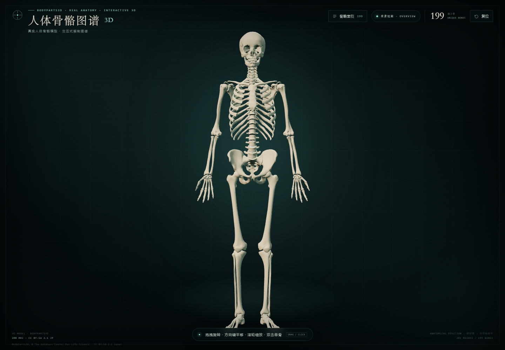
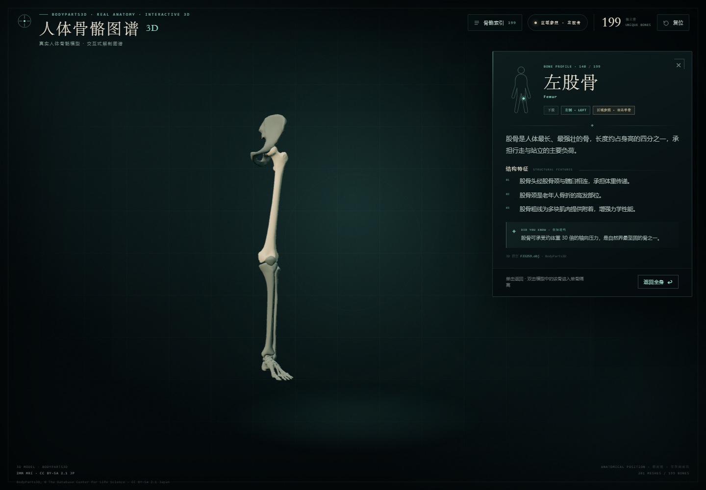
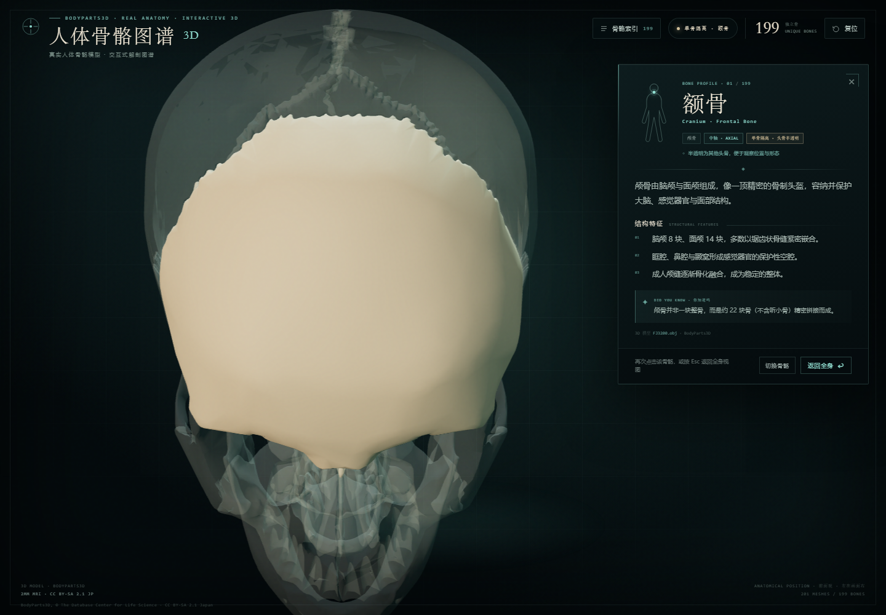

# 人体骨骼图谱 3D · 简介与使用说明

## 一、程序简介

**人体骨骼图谱 3D** 是一个面向解剖学习、科普展示和自主观察的交互式网页程序。它以 **BodyParts3D / Anatomography** 真实人体 MRI 重建数据为基础，将 **201 个骨骼模型部件** 压缩内嵌到网页中，无需安装软件、无需本地服务器，双击 `index.html` 即可在浏览器中打开。

程序把全身骨骼做成可旋转、可缩放、可检索的三维模型。单击骨骼可进入“区域参照”：本区域以暗色实体显示，其他区域保留为淡色轮廓，可直接点击切换到其他区域；双击骨骼则进入“单骨隔离”。头骨单骨隔离时，其余头骨以半透明轮廓保留，便于观察该骨在头骨中的位置与形态。方向键可以平移虚拟摄像机，方便沿股骨、胫骨等长骨逐段观察。

> 一句话简介：一个基于真实人体数据的、可直接在浏览器中打开的交互式 3D 骨骼图谱。

### 核心特点

- **真实模型**：BodyParts3D 真实人体 MRI 重建，201 个骨骼模型部件；
- **直接打开**：所有模型已内嵌，双击 `index.html` 即可运行，不需要服务器；
- **区域参照**：单击骨骼后本区域为暗色实体，其他区域为淡色轮廓，可直接点击切换，选中骨高亮；
- **单骨隔离**：双击任意骨骼，只显示该骨；头骨会保留其余头骨的半透明轮廓；
- **长骨观察**：方向键平移镜头，移动速度随缩放距离自动调整；
- **快速检索**：199 条骨骼索引，支持中文名、英文名、分区筛选和深链接；
- **桌面与手机适配**：手机端骨骼档案使用底部抽屉，索引使用全屏抽屉。

### 适用场景

- 解剖学课程演示与自主学习；
- 骨骼名称、位置和形态的直观记忆；
- 科普展览、作品集或教学网页展示；
- 需要离线运行、不能依赖服务器的演示环境。

## 二、三步打开

1. **解压**整个 `skeleton-3d` 文件夹；
2. **双击** `index.html`；
3. 等待加载进度完成，拖拽旋转模型即可开始使用。

> 请不要只移动 `index.html`。它需要同目录下的 `js/`、`css/` 和 `libs/` 文件才能正常运行。

### 运行环境

- Chrome / Edge 80+
- Firefox 113+
- Safari 16.4+

模型以约 13 MB 的压缩数据内嵌在 `js/models-embedded.js` 中，首次打开需要几秒钟解压和解析；浏览器缓存后再次打开会更快。

## 三、界面一览

- **中间 3D 视图**：显示全身骨骼，可旋转、缩放和平移；
- **左侧“骨骼索引”**：按颅骨、脊柱、胸廓、上肢、下肢分区浏览，或直接搜索骨骼名称；
- **右侧骨骼档案**：显示中文名、英文名、分区、侧别和结构特征；
- **底部提示**：显示当前鼠标/键盘操作提示；
- **右上角状态**：显示“全身视图”“区域参照”“单骨隔离”等当前模式。

## 四、基本操作

### 1. 旋转、缩放与平移视角

| 操作 | 效果 |
|---|---|
| 左键拖拽 | 旋转模型 |
| 右键拖拽 / Shift + 拖拽 | 平移视角 |
| 滚轮 / 双指捏合 | 缩放 |

### 2. 选择骨骼

- **单击骨骼**：进入 **区域参照模式**。本区域的骨骼以暗色实体显示，其他区域以淡色轮廓保留；点击淡色骨骼即可直接切换到那个区域，不必回到全身。
  - 例如单击左股骨：左髋骨、左股骨、左髌骨、左胫骨、左腓骨和左脚为暗色参照，其余骨骼为淡色轮廓；
  - 例如单击胸骨：胸廓和胸骨为暗色参照。
- **切换其他区域**：直接点击淡色轮廓，或点击面板底部的 **“切换骨骼”** 打开索引；选中其他骨骼后会直接进入新区域，不会先回到全身。
- **双击骨骼**：进入 **单骨隔离**。非头骨区域只显示该骨；头骨会保留其余头骨的半透明轮廓，便于观察当前位置与形态。
- **再次单击同一骨骼 / 按 `Esc`**：回到全身视图。

> 单击和双击通过点击间隔区分，单击会有约 260ms 的确认延迟；双击请快速连续点击两次。

### 3. 观察长骨

选中股骨、胫骨、肱骨等长骨后：

- 按 **`↑` `↓` `←` `→`**：平移虚拟摄像机，沿长骨上下左右移动观察位置；
- 按住方向键可连续移动，松开停止；
- 镜头越近，移动越精细，适合观察骨端、骨体和骨面细节；
- 按 **`[` / `]`**：切换上一块 / 下一块骨骼。

> 索引抽屉打开或搜索框聚焦时，方向键保留给界面滚动和光标移动，不会移动镜头。

### 4. 搜索与索引

- 点击左侧“骨骼索引”，输入中文名或英文名搜索；
- 按 **`/`** 快速打开索引并聚焦搜索框；
- 区域参照中打开索引不会重置视角，点击任意条目会直接切换到新区域；
- 点击索引条目可直接定位到对应骨骼；
- 支持深链接，例如 `index.html#FJ3259`（左股骨）。

### 5. 复位

以下操作都可以回到全身视图：

- 再次单击当前骨骼；
- 按 `Esc`；
- 点击空白区域；
- 点击右侧面板的关闭按钮或“返回全身”。

### 键盘速查

| 按键 | 功能 |
|---|---|
| `↑` `↓` `←` `→` | 平移摄像机 |
| `[` / `]` | 上一块 / 下一块骨骼 |
| `/` | 打开索引并聚焦搜索 |
| `Esc` | 关闭索引或返回全身 |

## 五、三种查看模式

| 模式 | 进入方式 | 显示内容 |
|---|---|---|
| 全身视图 | 初始状态 / 复位 | 全部 201 个模型部件 |
| 区域参照 | 单击骨骼 | 本区域为暗色实体，其他区域为淡色可点击轮廓，选中骨高亮 |
| 单骨隔离 | 双击骨骼 | 只显示当前骨块；头骨保留其余头骨的半透明轮廓 |

## 六、常见问题

**打开后加载时间较长？**
首次打开需要解压约 13 MB 的内嵌模型，通常几秒钟；后续打开会使用浏览器缓存。

**页面空白或模型不显示？**
确认解压的是完整文件夹，并且 `index.html` 与 `js/`、`css/`、`libs/` 在同一目录；建议使用最新版 Chrome 或 Edge。

**双击骨骼没有进入单骨隔离？**
双击需要两次点击间隔较短；也可以先单击进入区域参照，再快速双击该骨骼。

**为什么骨骼数量不是 206 块？**
源数据包含 202 条记录，去重和合并后为 199 个可交互条目、201 个渲染部件；源数据缺少听小骨和尾骨，模型来自 2 mm MRI 重建，细小骨骼可能不完整。

**手机上骨骼被面板挡住？**
手机端已为面板预留观察区域，可先拖拽旋转或缩放；关闭面板后即可查看全身。

## 七、数据与声明

- 模型来源：[BodyParts3D / Anatomography](https://dbarchive.biosciencedbc.jp/en/bodyparts3d/)
- 原始模型整理与网页参考：[jixiangying/skeleton](https://github.com/jixiangying/skeleton)
- 许可：BodyParts3D 数据遵循 **CC BY-SA 2.1 Japan**；完整引用见 [ATTRIBUTION.md](ATTRIBUTION.md)
- 本程序为解剖学教育与可视化演示，模型经过光照和材质艺术化处理，**不用于临床诊断、手术规划或解剖测量**。
